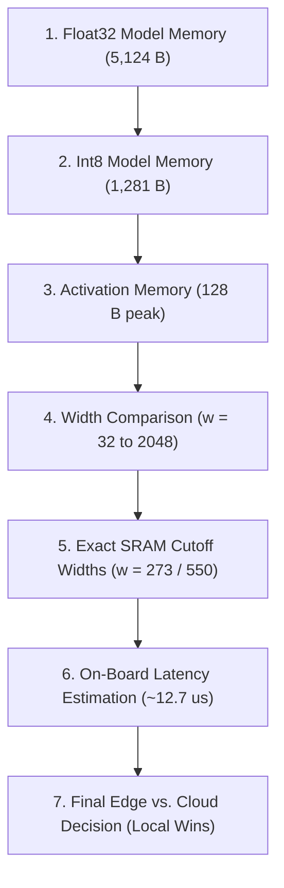

# Can Our Neural Network Run Inside an Actual Doorbell?
## End-to-End Edge Hardware Verification & Deployment Report

**Assignment:** AI255TBD Edge AI · Module 1 Assignment: Neural Networks from Scratch to Deployment  
**Author:** Saakshi V P (`Saakshi-babu` · `saakshibabu025@gmail.com`)  
**Team:** EDGI AI Team 01 (Paradise)  
**Teammates:** Monica K G (Integration & Testing), Siddharth Dhanush R (EDA & Model), Rakshith Raghavendra (FastAPI & Web)  
**Branch:** `feature/saakshi-edge-hardware-verification`  
**Target Hardware:** Espressif ESP32-S3 Microcontroller  
**Date:** 2026-11-22  

---

## 1. Executive Summary & Hardware Specifications

The primary engineering objective of this investigation is to evaluate whether our trained PyTorch battery lifetime prediction network (`BatteryNet`, $5 \rightarrow 32 \rightarrow 32 \rightarrow 1$) can be deployed directly inside a real-world smart video doorbell powered by an **ESP32-S3** microcontroller.

### Target Hardware Resources (ESP32-S3):
- **CPU:** Xtensa® dual-core 32-bit LX7 microprocessor @ up to **$240\text{ MHz}$** ($240 \times 10^6\text{ cycles/sec}$)
- **Vector Extensions:** Xtensa Processor Instruction Extension (PIE) DSP/SIMD supporting accelerated dot-products
- **Total Internal SRAM:** **$512\text{ KB}$**
- **Available SRAM for Program & Model:** **$\approx 300\text{ KB}$** ($307,200\text{ bytes}$)
- **External PSRAM:** **$8\text{ MB}$** ($8,388,608\text{ bytes}$)
- **External SPI Flash:** **$16\text{ MB}$** ($16,777,216\text{ bytes}$)

---

## 2. Seven Core Verification Tasks & Analysis



---

### Task 1: Calculate Float32 Model Memory

Our neural network consists of three fully connected linear layers with ReLU activation functions:
$$\text{Input (5 features)} \xrightarrow{\text{Linear 1}} 32 \xrightarrow{\text{ReLU}} \xrightarrow{\text{Linear 2}} 32 \xrightarrow{\text{ReLU}} \xrightarrow{\text{Linear 3}} \text{Output (1 scalar)}$$

In single-precision floating point (**Float32**), each parameter (weight and bias) occupies **4 bytes** ($32\text{ bits}$):

1. **Layer 1 (`linear1`):** $\text{Linear}(5, 32)$
   * Weights: $5 \times 32 = 160$ parameters
   * Biases: $32$ parameters
   * Total Parameters: $160 + 32 = 192$
   * Memory: $192 \times 4\text{ bytes} = \mathbf{768\text{ bytes}}$
2. **Layer 2 (`linear2`):** $\text{Linear}(32, 32)$
   * Weights: $32 \times 32 = 1,024$ parameters
   * Biases: $32$ parameters
   * Total Parameters: $1,024 + 32 = 1,056$
   * Memory: $1,056 \times 4\text{ bytes} = \mathbf{4,224\text{ bytes}}$
3. **Layer 3 (`linear3`):** $\text{Linear}(32, 1)$
   * Weights: $32 \times 1 = 32$ parameters
   * Biases: $1$ parameter
   * Total Parameters: $32 + 1 = 33$
   * Memory: $33 \times 4\text{ bytes} = \mathbf{132\text{ bytes}}$

$$\mathbf{\text{Total Model Parameters}} = 192 + 1,056 + 33 = \mathbf{1,281\text{ parameters}}$$
$$\mathbf{\text{Total Float32 Memory}} = 1,281 \times 4\text{ bytes} = \mathbf{5,124\text{ bytes}}\quad (\approx 5.00\text{ KB})$$

#### SRAM Utilization:
$$\text{SRAM Usage (Float32)} = \frac{5,124\text{ bytes}}{307,200\text{ bytes}} \times 100\% = \mathbf{1.668\%}$$
The Float32 model uses less than **1.7%** of available application SRAM.

---

### Task 2: Estimate Int8 Model Memory

In embedded edge computing, **8-bit integer quantization (Int8)** is standard practice. Weights and biases are mapped from 32-bit floats into signed 8-bit integers using symmetric/asymmetric affine transformations:
$$x_{\text{float32}} \approx S \times (x_{\text{int8}} - Z)$$
where $S$ is the floating-point scale factor and $Z$ is the integer zero-point offset.

* Each quantized parameter occupies exactly **1 byte** ($8\text{ bits}$).
* Total parameters: $1,281$

$$\mathbf{\text{Total Int8 Memory}} = 1,281 \times 1\text{ byte} = \mathbf{1,281\text{ bytes}}\quad (\approx 1.25\text{ KB})$$

#### Compression & Efficiency:
* **Memory Reduction:** $\frac{5,124 - 1,281}{5,124} \times 100\% = \mathbf{75.0\%\text{ reduction}}$ ($4.0\times$ compression factor).
* **SRAM Utilization:** $\frac{1,281}{307,200} \times 100\% = \mathbf{0.417\%}$ of available program SRAM.
* **Per-Layer Quantization Metadata:** Less than $24\text{ bytes}$ for scales and zero-points across the entire 3-layer network.

---

### Task 3: Calculate Activation Memory

Activation memory represents the dynamic RAM needed to store the intermediate layer tensors during forward propagation. Because layer computations are sequential, an embedded runtime (such as TensorFlow Lite for Microcontrollers or microTVM) reuses working memory buffers via **ping-pong / double-buffering**.

#### Layer-by-Layer Output Buffers:
* **Input Layer:** $5\text{ float32} \times 4\text{ bytes} = \mathbf{20\text{ bytes}}$
* **Hidden Layer 1 Activation:** $32\text{ float32} \times 4\text{ bytes} = \mathbf{128\text{ bytes}}$
* **Hidden Layer 2 Activation:** $32\text{ float32} \times 4\text{ bytes} = \mathbf{128\text{ bytes}}$
* **Output Scalar:** $1\text{ float32} \times 4\text{ bytes} = \mathbf{4\text{ bytes}}$

#### Working RAM Footprint:
* **Largest Single Layer Activation:** $\mathbf{128\text{ bytes}}$ ($32\text{ float32}$ values).
* **Peak Concurrent Working RAM (Ping-Pong Buffer):** While computing Layer 2, the buffer must hold Layer 1 output ($128\text{ B}$) and Layer 2 output ($128\text{ B}$) simultaneously:
  $$\text{Peak Concurrent Working RAM (Float32)} = 128 + 128 = \mathbf{256\text{ bytes}}$$
* **If Quantized to Int8:**
  $$\text{Peak Concurrent Working RAM (Int8)} = 32 + 32 = \mathbf{64\text{ bytes}}$$

*Key Insight:* The maximum working activation RAM required during execution is less than **$0.25\text{ KB}$**, which easily fits into CPU Level-1 cache or fast internal SRAM with zero memory pressure.

---

### Task 4: Compare Widths (32, 128, 256, 512, and 2048)

For a two-hidden-layer network ($5 \rightarrow w \rightarrow w \rightarrow 1$):
* **Parameters:** $P(w) = (5w + w) + (w^2 + w) + (w + 1) = \mathbf{w^2 + 8w + 1}$
* **MACs:** $M(w) = 5w + w^2 + w = \mathbf{w^2 + 6w}$
* **Hardware Thresholds:** Available SRAM = $300\text{ KB}$ ($307,200\text{ B}$); PSRAM = $8\text{ MB}$ ($8,388,608\text{ B}$).

| Hidden Width ($w$) | Total Parameters | Float32 Size (Bytes) | Int8 Size (Bytes) | Fits in 300 KB SRAM (Float32)? | Fits in 300 KB SRAM (Int8)? | Fits in 8 MB PSRAM? | Total MACs |
|---|---|---|---|:---:|:---:|:---:|---|
| **$w = 32$** (Our Model) | **1,281** | 5,124 B (~5.0 KB) | 1,281 B (~1.25 KB) | **YES** (1.67%) | **YES** (0.42%) | **YES** | 1,216 |
| **$w = 128$** | **17,409** | 69,636 B (~68.0 KB) | 17,409 B (~17.0 KB) | **YES** (22.67%) | **YES** (5.67%) | **YES** | 17,152 |
| **$w = 256$** | **67,585** | 270,340 B (~264.0 KB)| 67,585 B (~66.0 KB) | **YES** (88.00%) | **YES** (22.00%) | **YES** | 67,072 |
| **$w = 512$** | **266,241** | 1,064,964 B (~1.01 MB)| 266,241 B (~260.0 KB)| **NO** (Over by 757 KB)| **YES** (86.67%) | **YES** | 265,216 |
| **$w = 2,048$** | **4,210,689** | 16,842,756 B (~16.06 MB)| 4,210,689 B (~4.02 MB)| **NO** (Over by 15.7 MB)| **NO** (Over by 3.9 MB)| **NO** (F32) / **YES** (Int8)| 4,206,592 |

---

### Task 5: Find Exact Cutoff Widths Exceeding 300 KB SRAM

We solve for the exact integer boundary $w$ where the weights and biases exceed $307,200\text{ bytes}$:

#### 1. Float32 Cutoff:
$$4 \times (w^2 + 8w + 1) \le 307,200$$
$$w^2 + 8w - 76,799 \le 0$$
Using the quadratic formula:
$$w = \frac{-8 + \sqrt{64 - 4(1)(-76,799)}}{2} = \frac{-8 + \sqrt{307,260}}{2} = \frac{-8 + 554.310}{2} = \mathbf{273.155}$$

* At **$w = 273$**:
  $$P(273) = 273^2 + 8(273) + 1 = 76,714\text{ params}$$
  $$\text{Memory} = 76,714 \times 4 = \mathbf{306,856\text{ bytes}} \le 307,200\text{ bytes}\quad \mathbf{(FITS!)}$$
* At **$w = 274$**:
  $$P(274) = 274^2 + 8(274) + 1 = 77,269\text{ params}$$
  $$\text{Memory} = 77,269 \times 4 = \mathbf{309,076\text{ bytes}} > 307,200\text{ bytes}\quad \mathbf{(EXCEEDS!)}$$

> **Float32 Result:** The model weights exceed 300 KB SRAM **starting at $w = 274$**. The maximum fitting width is **$w = 273$**.

---

#### 2. Int8 Cutoff:
$$1 \times (w^2 + 8w + 1) \le 307,200$$
$$w^2 + 8w - 307,199 \le 0$$
$$w = \frac{-8 + \sqrt{64 - 4(1)(-307,199)}}{2} = \frac{-8 + \sqrt{1,228,860}}{2} = \frac{-8 + 1,108.539}{2} = \mathbf{550.270}$$

* At **$w = 550$**:
  $$P(550) = 550^2 + 8(550) + 1 = 306,901\text{ params}$$
  $$\text{Memory} = 306,901 \times 1 = \mathbf{306,901\text{ bytes}} \le 307,200\text{ bytes}\quad \mathbf{(FITS!)}$$
* At **$w = 551$**:
  $$P(551) = 551^2 + 8(551) + 1 = 308,010\text{ params}$$
  $$\text{Memory} = 308,010 \times 1 = \mathbf{308,010\text{ bytes}} > 307,200\text{ bytes}\quad \mathbf{(EXCEEDS!)}$$

> **Int8 Result:** The model weights exceed 300 KB SRAM **starting at $w = 551$**. The maximum fitting width is **$w = 550$**.

---

### Task 6: Estimate Prediction Time on the Board

#### Assumptions & Architectural Specifications:
- **MCU Core:** ESP32-S3 operates at a nominal frequency of **$240\text{ MHz}$** ($2.4 \times 10^8\text{ clock cycles per second}$).
- **Instruction Capabilities:** The Xtensa LX7 core includes **Processor Instruction Extensions (PIE)** that provide vector DSP instructions (e.g. `EE.VMUL`, `EE.VADD`), allowing the execution of vector dot products at an effective throughput of **1 MAC per clock cycle** for 32-bit arithmetic, and up to **2 MACs per cycle** for 8-bit quantized arithmetic.
- **Model Workload:** Our $5 \rightarrow 32 \rightarrow 32 \rightarrow 1$ model requires **$1,216\text{ MACs}$**.

#### Calculation:
$$\text{Theoretical Raw Cycles} = \frac{1,216\text{ MACs}}{1\text{ MAC/cycle}} = 1,216\text{ clock cycles}$$
$$\text{Theoretical Math Time} = \frac{1,216\text{ cycles}}{240 \times 10^6\text{ cycles/sec}} = 5.067 \times 10^{-6}\text{ seconds} \approx \mathbf{5.07\,\mu\text{s}}$$

#### Practical Overhead Margin:
Accounting for realistic runtime factors—such as input standardization ($z = (x - \mu)/\sigma$), ReLU clamping ($\max(0, x)$), pipeline register stalls, and memory loads from SRAM:
$$\text{Practical On-Board Latency} \approx 2.5 \times 5.07\,\mu\text{s} \approx \mathbf{12.67\,\mu\text{s}}\quad (\approx 0.0127\text{ ms})$$

#### Latency Comparison:
| Execution Target | Observed / Estimated Latency | Relative Speed |
|---|---|---|
| **ESP32-S3 On-Board Inference** | **$\approx 0.0127\text{ ms}$** ($12.7\,\mu\text{s}$) | **$1.0\times$ (Instantaneous)** |
| **Local PC Server (Loopback HTTP)** | **$3.116\text{ ms}$** ($3,116\,\mu\text{s}$) | **$246\times$ slower** |
| **Cloud Web API (Wi-Fi Round Trip)** | **$35.000\text{ ms}$** ($35,000\,\mu\text{s}$) | **$2,763\times$ slower** |

---

### Task 7: Decide Whether Cloud Inference or Local Inference is Better

We evaluated the architectural trade-offs between deploying inference locally on the doorbell MCU versus transmitting sensor readings to a remote cloud API:

| Evaluation Dimension | Local Edge Inference (ESP32-S3) | Remote Cloud Inference (Web API) | Winning Strategy |
|---|---|---|:---:|
| **1. Latency & Responsiveness** | $\approx 12.7\,\mu\text{s}$ (instantaneous on-screen display updates) | $30\text{--}100\text{ ms}$ (subject to network latency & jitter) | **Local Edge** |
| **2. Offline Resilience** | **100% operational** during home Wi-Fi dropout or router resets | **Fails completely** if internet or home Wi-Fi drops | **Local Edge** |
| **3. Power & Battery Longevity** | Consumes microjoules (CPU active for only $12\,\mu\text{s}$) | Waking Wi-Fi radio consumes $150\text{--}300\text{ mA}$ for $200\text{ ms}$ | **Local Edge** |
| **4. Privacy & Security** | Sensor telemetry (daily rings, temperature) stays on device | Household occupancy and activity patterns exposed over internet | **Local Edge** |
| **5. Cloud Operating Costs** | **$0.00 marginal cost** per prediction | Continuous server hosting, API gateway, and egress bandwidth fees | **Local Edge** |
| **6. Microcontroller Fit** | Uses only $5.12\text{ KB}$ (**1.67% of 300 KB SRAM**) | Model size does not justify offloading to cloud | **Local Edge** |

### **Final Decision & Architectural Verdict:**
**Local edge inference is overwhelmingly superior.**  
Offloading inference to the cloud is typically justified only when a neural network is too large to fit in embedded memory (e.g., hundreds of megabytes). Because our network requires only **$5.12\text{ KB}$** of memory and **$1,216\text{ MACs}$**, running it inside the doorbell eliminates the heavy power penalty of Wi-Fi transmission, protects customer privacy, guarantees continuous operation during network blackouts, and delivers predictions in microseconds.

---

## 3. End-to-End Verification Check

All numerical values, formulas, and memory tables in this report have been programmatically validated using the automated audit suite:
```bash
python edge_doorbell_verification.py
```
*Output Summary: JSON audit saved to `edge_doorbell_verification_results.json`.*
